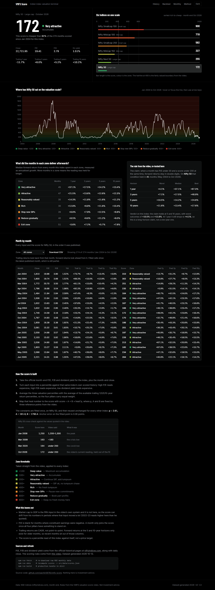

# VMFS Score

A dark, data-first terminal that answers one question about six NSE indices: **how expensive is this market right now, and how did that reading work out for investors afterwards?**

Every month since 2004 gets a single number — the VMFS valuation score — built only from official NSE data: P/E, P/B, dividend yield and trailing 1/3/5/10-year returns.



## The six indices

Nifty 50 · Nifty Next 50 · Nifty Midcap 100 · Nifty Midcap 150 · Nifty Smallcap 100 · Nifty Smallcap 250

## How the score is built

1. Take the official month-end P/E, P/B, dividend yield and closing price for the index.
2. Turn each input into a percentile against that same index's own scored history — high P/E expensive, high P/B expensive, low dividend yield expensive.
3. Average the three valuation percentiles with the average of the available trailing-return percentiles, so the four pillars carry equal weight.
4. Map that heat number onto the score with `score = A + B × heat^p`.

`p = 2.910`, `A = 161.9`, `B = 1790.4` are fitted once, on Nifty 50, so three reference points quoted in the source video are reproduced: the median month lands on 400, Mar 2009 lands on 163, Jan 2008 lands on 1250. The same constants are then reused, unchanged, for every other index.

**Zone thresholds** (from the video): `<100` deep value · `100+` very attractive · `200+` attractive · `300+` reasonably valued · `400+` rich · `500+` stop new SIPs · `600+` reduce gradually · `800+` exit zone.

## What is in the app

- **Focal readout** — the current score, its zone, the action line, and the four pillar inputs.
- **Six indices on one scale** — every index on a shared rail, sorted rich to cheap; clicking one switches the whole page.
- **Score history** — the score plotted over its zone bands since 2004, hoverable and keyboard-navigable.
- **Zone backtest** — median 1/3/5/10-year forward return for every month spent in each zone.
- **The claim, re-tested** — the video's rule (P/E under 20 and score under 200) run against this index, with a computed verdict.
- **Month-by-month table** — every input and score, filterable by zone, downloadable as CSV.
- **Method** — the formula, the cross-check against the video's quoted values, and what this leaves out.

## Run it

```bash
npm install
npm run dev        # local dev server
npm run build      # production bundle in dist/
npm run preview    # serve the built bundle
```

Refresh the data (NSE publishes new monthly P/E, P/B, dividend yield and closes):

```bash
npm run fetch      # re-download raw monthly data -> data/score_raw_data.json
npm run data       # recompute scores -> src/data/scores.json
npm run build
```

## Deploy

The repo is set up for Vercel zero-config (see `vercel.json`: Vite, `npm run build`, output `dist`, Node 24). Import `sachin5678/vmfs-score` in the Vercel dashboard and every push to `main` redeploys. GitHub Pages works too — `base: './'` in `vite.config.js` already makes `dist/` portable.

## Layout

```
scripts/fetch-raw.mjs      NSE monthly data fetcher (P/E, P/B, dividend yield, OHLC)
scripts/build-data.mjs     percentiles + calibration -> src/data/scores.json
data/score_raw_data.json   cached raw NSE data
src/lib/data.js            row schema, stats, zone/claim backtests, CSV export
src/components/            Focal, ScoreHistory, Evidence, MonthlyTable, Method
DESIGN.md                  design direction, tokens and reasons
```

## Limits, on purpose

- Market cap to GDP is the fifth input in the video's own system and is **not** used here, so the score can drift from his numbers where that input moved a lot (2022–23 reads higher here than he quoted).
- P/E is blank for months where constituent earnings were negative; a month joins the score only once all four pillars have something to stand on.
- Trailing returns are CAGR. Forward returns at 5 and 10 years only exist for older months.
- The score is a percentile read of an index against itself, not a price target.

Data: [niftyindices.com](https://www.niftyindices.com). Scoring rules from [this video](https://youtu.be/V2U4z-9wQ4k). Not investment advice.
